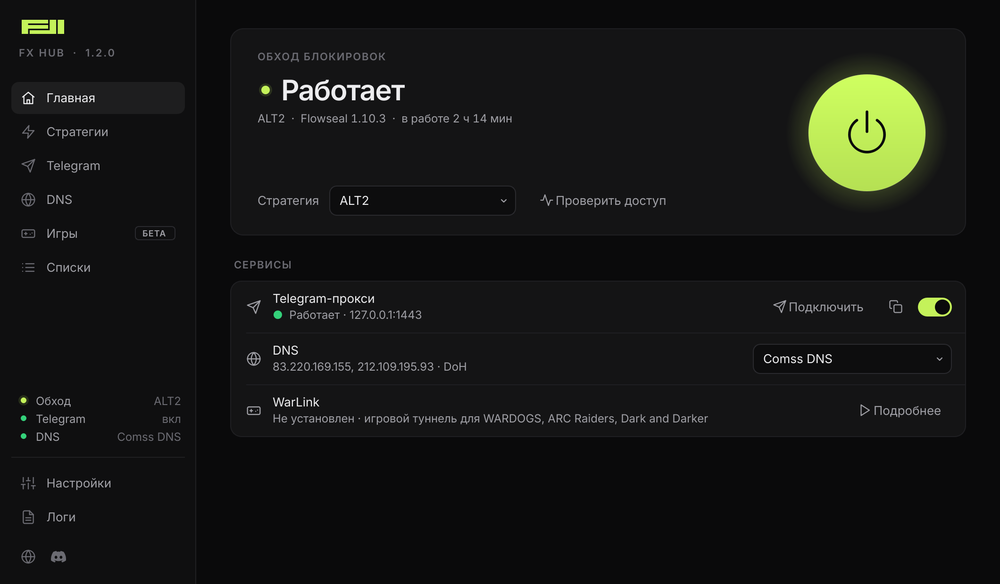

  <picture>
    <source media="(prefers-color-scheme: dark)" srcset="docs/logo-dark.svg">
    
  </picture>

<h1 align="center">FX HUB</h1>

  Обход блокировок, Telegram и нейросети без VPN. 
  Одна программа для Windows 10 и 11.

  <a href="https://github.com/fxxnxx/FX_HUB/releases/latest/download/FX_HUB-win64.zip">
    <picture>
      <source media="(prefers-color-scheme: dark)" srcset="docs/download-dark.svg">
      
    </picture>
  </a>

  <a href="https://github.com/fxxnxx/FX_HUB/releases">Все версии и что в них нового</a>

 

  

## Как начать

1. Нажмите «Скачать для Windows» выше. Скачается архив `FX_HUB-win64.zip`.
2. Распакуйте его в короткую папку без русских букв, например `C:\FX_HUB`.
3. Откройте `FX_HUB.exe` и разрешите запуск от имени администратора. Без этого обход и DNS не заработают.
4. Нажмите большую кнопку включения на главной.

Скачивать новые версии вручную не нужно. Программа сама сообщит об обновлении и поставит его по кнопке, настройки сохранятся.

## Что умеет

**Обход блокировок.** Работает на стратегиях zapret от Flowseal. Кнопка «Проверить все» перебирает их и включает рабочую с самым низким пингом.

**Telegram.** Встроенный прокси TG WS Proxy включается вместе с обходом. В Telegram он добавляется одной кнопкой «Подключить».

**Нейросети.** Готовые DNS-профили Comss DNS, DNS-AI и Xbox DNS, можно добавить и свои. У каждого профиля видно, открывает ли он нейросети прямо сейчас. В Windows 11 запросы к DNS шифруются.

**Сервисы через hosts.** Отметьте в списке нужное: ChatGPT, Claude, Gemini, Spotify и ещё около сотни сервисов. Они откроются через прокси GeoHideDNS, даже если провайдер подменяет DNS. Список обновляется сам.

**Игры.** WarLink для WARDOGS, ARC Raiders и Dark and Darker ставится по кнопке.

## Если что-то не работает

- Антивирус удалил файлы. Обход работает через драйвер WinDivert, и на него иногда реагируют антивирусы. Добавьте папку FX HUB в исключения и нажмите «Восстановить» в программе.
- Перестали открываться сайты. Откройте «Стратегии» и нажмите «Проверить все».
- Нейросеть пишет, что недоступна в вашей стране. Откройте раздел DNS и выберите профиль с пометкой «Нейросети открывает» или включите «Сервисы через hosts».
- Включена другая программа обхода. Одновременно может работать только одна, закройте лишнюю.

## Связь

Сайт [balbasov.ru](https://balbasov.ru). Вопросы и ошибки пишите в [Discord](https://discordapp.com/users/353830271298043905).

## Спасибо авторам

FX HUB управляет программами, которые сделали другие люди:

- [zapret-discord-youtube](https://github.com/Flowseal/zapret-discord-youtube) от Flowseal и [zapret](https://github.com/bol-van/zapret) от bol-van, лицензия MIT
- [WinDivert](https://github.com/basil00/WinDivert) от basil00, LGPLv3
- [TG WS Proxy](https://github.com/Flowseal/tg-ws-proxy) от Flowseal, MIT
- [WarLink](https://github.com/max-alekseyev/WarLink) от Max Alekseyev, MIT
- [GeoHideDNS](https://github.com/Internet-Helper/GeoHideDNS) от Internet-Helper, список адресов для «Сервисов через hosts»
- [Qt for Python](https://www.qt.io/qt-for-python), LGPLv3

Полные тексты лицензий лежат в папке `licenses` внутри архива.
